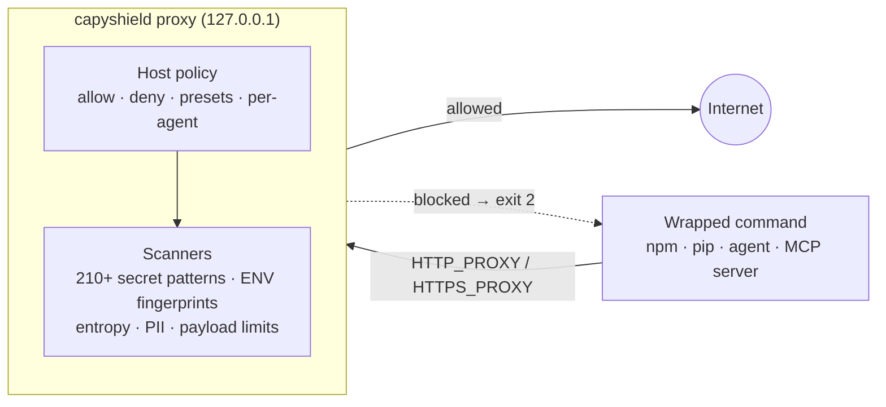

<div align="center">

# CapyShield

**A deterministic, zero-trust egress guard and local VEX/reachability engine.**

Stop secrets from leaving your build, CI or AI agent, and cut CVE noise down to what your code actually reaches.

[](https://github.com/capyshield-hq/capyshield/actions/workflows/ci.yml)
[](https://github.com/capyshield-hq/capyshield/releases)
[](https://crates.io/crates/capyshield)
[](https://pypi.org/project/capyshield/)
[](LICENSE)

[Install](#installation) · [Quickstart](#quickstart) · [Egress guard](#egress-guard) · [VEX & reachability](#vex--reachability) · [Configuration](#configuration) · [CI & agents](#integrations)

</div>

---

CapyShield is a single static Rust binary with two jobs:

- **Egress guard.** It wraps any command (`npm install`, `pip install`, `cargo build`, a coding agent, an MCP server) and records every outbound connection. When you enforce a policy, it blocks credential and ENV-secret leaks and connections to hosts you haven't allowed.
- **VEX & reachability.** It takes a Trivy or Grype report and checks each finding against your lockfiles and production imports. It writes standard **OpenVEX**, so your scanner, auditors and customers stop chasing CVEs your code never reaches.

It runs entirely on your machine. There's no account, no API key, and no telemetry. Source code, git history and secret values never leave the host.

```console
$ capyshield watch -- npm install
capyshield: audit mode, sni TLS, 1 sensitive ENV value(s) fingerprinted, proxy http://127.0.0.1:60597
added 1 package in 487ms

ACTION   DESTINATION              PROTOCOL   CONNS       SENT  RULE
allowed  registry.npmjs.org:443   https-sni      2     4.6 KB
capyshield: 2 connection(s) to 1 host(s)
```

## Contents

- [Installation](#installation)
- [Quickstart](#quickstart)
- [Egress guard](#egress-guard)
- [VEX & reachability](#vex--reachability)
- [Configuration](#configuration)
- [Integrations](#integrations)
- [Exit codes](#exit-codes)
- [Privacy](#privacy)
- [Performance](#performance)
- [Security model & limitations](#security-model--limitations)
- [How it works (architecture & diagrams)](docs/how-it-works.md)
- [Contributing](#contributing)

## Installation

CapyShield ships as one self-contained binary for **Linux** (x86_64, arm64; glibc and musl) and **macOS** (Apple Silicon, Intel, universal).

| Method | Command |
|---|---|
| **uv** (run without installing) | `uvx capyshield watch -- npm install` |
| **uv** (install as a tool) | `uv tool install capyshield` |
| **pipx / pip** | `pipx install capyshield` or `pip install capyshield` |
| **npm** (run without installing) | `npx capyshield watch -- npm install` |
| **npm** (install) | `npm install -g capyshield` or `npm install -D capyshield` |
| **Cargo** | `cargo install capyshield --locked` |
| **Homebrew** | `brew install capyshield-hq/tap/capyshield` |
| **Docker** | `docker run --rm -v "$PWD:/src" -w /src ghcr.io/capyshield-hq/capyshield:latest --help` |
| **Prebuilt binaries** | [GitHub Releases](https://github.com/capyshield-hq/capyshield/releases), with a SHA-256 checksum and SLSA build provenance for every archive |
| **GitHub Actions** | `uses: capyshield-hq/capyshield/action@v1` |

The PyPI and npm packages contain only the native binary. PyPI ships it as a platform wheel. npm ships a small launcher plus a per-platform `@capyshield/<os>-<cpu>` package, and installs only the one that matches your machine. Neither has runtime dependencies.

To verify a downloaded release:

```bash
shasum -a 256 -c capyshield-x86_64-unknown-linux-musl.tar.gz.sha256
gh attestation verify capyshield-x86_64-unknown-linux-musl.tar.gz --repo capyshield-hq/capyshield
```

## Quickstart

```bash
# 1. See what a command talks to. Zero config, nothing blocked.
capyshield watch -- npm install

# 2. Turn what you saw into a policy, then enforce it (exit 2 on violation).
capyshield watch --emit-policy capyshield.yaml -- npm ci
capyshield guard --config capyshield.yaml -- npm ci

# 3. Triage CVEs by reachability and emit OpenVEX.
trivy fs --format json -o trivy-report.json .
capyshield vex --input trivy-report.json --repo . --output release.openvex.json

# 4. Hand the VEX back to your scanner. not_affected findings are suppressed.
trivy fs --vex release.openvex.json .
```

For a richer starting point, `capyshield init` writes a documented `capyshield.yaml`, a `.capyshield/vex-rules.yaml`, and a local root CA for HTTPS inspection.

## Egress guard

`watch` and `guard` start a local proxy on `127.0.0.1` and run your command with `HTTP_PROXY`, `HTTPS_PROXY` and `ALL_PROXY` (upper and lower case) pointing at it. Every connection is recorded with `timestamp`, `destination_host`, `port`, `protocol`, `bytes_sent`, `action` (`allowed` | `blocked` | `audited`) and `rule_id`. Add `--report events.json` to save the log.



How the proxy decides, step by step (CONNECT/SNI vs MITM, request inspection, the scanner pipeline, fail modes and the VEX triage tree), is described with diagrams in **[docs/how-it-works.md](docs/how-it-works.md)**.

### Detection

| Check | What it catches |
|---|---|
| **Host policy** | Destinations outside `allow_hosts` or `allow_presets`, anything matching `deny_hosts`, and domain fronting (SNI or `Host` header that doesn't match the CONNECT target) |
| **Credential patterns** | 210+ formats: AWS, GCP, Azure, GitHub, GitLab, Stripe, OpenAI, Anthropic, Slack, database URIs, private keys and more. An Aho-Corasick prefilter means a regex only runs when its keyword is present. |
| **ENV fingerprints** | Values of sensitive variables (`*KEY*`, `*SECRET*`, `*TOKEN*`, `*PASSWORD*`, …), matched as plain, Base64, URL-encoded and hex. Findings carry only the variable name. |
| **Entropy** | High-entropy query parameters and custom headers sent to hosts that aren't allow-listed |
| **PII** | `credit_card` (Luhn-checked), `email`, `ssn`, `nik`, `private_key` |
| **Payload limits** | `max_outbound_bytes` per request or tunnel, for hosts that aren't allow-listed |

A credential in an authentication header (`Authorization`, `X-Api-Key`, …) sent to an allow-listed host is treated as normal authentication. The same credential in a body, URL or custom header, or sent to any other host, is treated as a leak. `secret_allow` permits a specific secret to go to specific hosts.

### TLS modes

| Mode | Behavior | Use when |
|---|---|---|
| `sni` (default) | Checks the CONNECT target and TLS SNI, and counts bytes sent. Nothing is decrypted. | You want near-zero overhead and host-level control. |
| `mitm` | Terminates TLS with per-host certificates from a local CA, so headers, URL and body are all inspected. The CA is injected only into the wrapped process (`NODE_EXTRA_CA_CERTS`, `SSL_CERT_FILE`, `REQUESTS_CA_BUNDLE`, `CURL_CA_BUNDLE`, `PIP_CERT`, `GIT_SSL_CAINFO`, …) and never into the system trust store. | You need payload inspection, e.g. to catch ENV secrets sent over HTTPS. |

Clients that pin certificates go in `tls_bypass_hosts`, and fall back to SNI mode.

### Enforcement modes

| Mode | Policy violation | Inspection failure |
|---|---|---|
| `audit` | Logged, allowed | Allowed |
| `enforce_fail_open` | Blocked | Allowed. If the proxy can't start, the command runs unguarded with a warning. |
| `enforce_fail_closed` | Blocked | Blocked, e.g. non-TLS traffic inside a CONNECT tunnel or a certificate generation failure |

## VEX & reachability

`capyshield vex` reads `trivy … --format json` or `grype … -o json` output and derives deterministic facts for each finding:

| Fact | How it's derived |
|---|---|
| `in_lockfile` | `package-lock.json`, `npm-shrinkwrap.json`, `pnpm-lock.yaml`, `yarn.lock`, `poetry.lock`, `uv.lock`, `requirements*.txt` |
| `dependency_scope` | `direct` · `transitive` · `dev_only` · `not_found`, from `package.json`, `pyproject.toml` (PEP 621, Poetry, uv, dependency groups) and lockfile dev markers |
| `imported_in_prod` | `import`, `require()`, dynamic `import()` and `from … import` in production code. Packages run through npm `scripts` also count. Test files (`test/`, `tests/`, `__tests__/`, `*.spec.*`, `*.test.*`, `test_*.py`) and `exclude_paths` are ignored. |
| `matched_files_count` | Number of production files that import the package |

Each finding is decided in this order:

1. **Local rules** in `.capyshield/vex-rules.yaml`, versioned with your code.
2. **Team rules** from CapyShield Cloud, only with `--sync`.
3. **Reachability:**
   - a `dev_only` package, or a direct dependency that production code never imports, is `not_affected` (`vulnerable_code_not_in_execute_path`)
   - a package imported in production is `affected`, with an upgrade `action_statement`
   - anything else is `under_investigation`

```bash
capyshield vex --scanner trivy --input trivy-report.json --repo . \
  --output release.openvex.json --summary vex.md --fail-on high,critical
```

The output is plain [OpenVEX v0.2.0](https://github.com/openvex/spec). Trivy (`--vex`), Grype, vexctl and other OpenVEX consumers can read it. The facts are recorded in each statement's `status_notes`. Set `SOURCE_DATE_EPOCH` to make the document byte-for-byte reproducible.

```yaml
# .capyshield/vex-rules.yaml
rules:
  - vulnerability: CVE-2020-14343
    package: PyYAML               # name or purl; omit to match any package
    status: not_affected
    justification: vulnerable_code_cannot_be_controlled_by_adversary
    impact_statement: "Only yaml.safe_load on trusted config files."
```

## Configuration

`capyshield.yaml` is declarative, and unknown keys are rejected: a typo exits with code `1` instead of silently weakening your policy.

```yaml
version: 1
mode: enforce              # audit | enforce
fail_mode: fail_closed     # fail_open | fail_closed

egress:
  tls_inspection: mitm     # sni | mitm
  tls_bypass_hosts: ["*.apple.com"]
  allow_presets: ["npm", "python", "openai"]
  allow_hosts: ["npm.pkg.example.com"]          # extra hosts, e.g. a private registry
  deny_hosts: ["*.ngrok-free.app", "webhook.site"]
  max_outbound_bytes: 131072                     # hosts outside the allowlist
  scan:
    builtin_secret_patterns: true
    runtime_env_fingerprints: true
    env_include: []                              # extra ENV names to fingerprint
    env_exclude: ["PATH", "HOME", "PWD", "LANG"]
    high_entropy: true
    entropy_threshold: 4.2
    pii_patterns: ["credit_card", "private_key"] # + email, ssn, nik
    secret_allow:                                # secret → hosts it may reach
      OPENAI_API_KEY: ["api.openai.com"]

agents:                                          # selected by X-Agent-ID or --agent-id
  coding-agent:
    allow_hosts: ["api.anthropic.com"]           # replaces the global allowlist
    max_outbound_bytes: 65536

vex:
  ecosystems: ["node", "python"]
  exclude_paths: ["tests/**", "**/__tests__/**", "docs/**"]
  redact_paths: true
  local_rules_file: ".capyshield/vex-rules.yaml"
```

Host patterns are `exact.host`, `*.domain` (subdomains only) or `*`.

### Host presets

`allow_presets` expands named groups of registry and API hosts that are maintained with each release. Run `capyshield presets` to list them.

| Preset | Hosts |
|---|---|
| `npm` | registry.npmjs.org, registry.yarnpkg.com, repo.yarnpkg.com |
| `nodejs` | nodejs.org |
| `python` | pypi.org, files.pythonhosted.org |
| `pytorch` | download.pytorch.org |
| `rust` | crates.io, index.crates.io, static.crates.io, static.rust-lang.org |
| `go` | proxy.golang.org, sum.golang.org |
| `docker` | registry-1.docker.io, auth.docker.io, production.cloudflare.docker.com |
| `anthropic` · `openai` | api.anthropic.com · api.openai.com |
| `github` ⚠ | github.com, api.github.com, codeload.github.com, objects/raw/release-assets.githubusercontent.com |
| `gitlab` ⚠ | gitlab.com, registry.gitlab.com |
| `bitbucket` ⚠ | bitbucket.org, api.bitbucket.org, bbuseruploads.s3.amazonaws.com |
| `chrome-for-testing` ⚠ | storage.googleapis.com |

⚠ These hosts serve content anyone can upload, so they can also carry exfiltrated data. Enable them only if your build needs them. Request bodies and URLs sent to them are still scanned for secrets. Self-hosted GitLab, Bitbucket Data Center or GitHub Enterprise instances aren't presets; add their hostnames to `allow_hosts`.

To build a tight allowlist, run your build once with `capyshield watch --emit-policy capyshield.allow.yaml -- <build>`. The generated file lists every host the build reached and notes which preset covers each one.

## Integrations

### GitHub Actions

```yaml
- uses: capyshield-hq/capyshield/action@v1
- run: capyshield guard --config capyshield.yaml --report egress.json -- npm ci
- run: |
    trivy fs --format json -o trivy.json .
    capyshield vex --input trivy.json --repo . --output release.openvex.json --fail-on high,critical
```

### AI coding agents & MCP servers

```bash
capyshield guard --config capyshield.yaml --agent-id claude-code -- claude
```

```json
{
  "mcpServers": {
    "fetch": {
      "command": "capyshield",
      "args": ["guard", "--config", "capyshield.yaml", "--agent-id", "mcp-fetch", "--", "uvx", "mcp-server-fetch"]
    }
  }
}
```

CapyShield writes only to stderr, so an MCP server's stdio JSON-RPC channel is untouched. Every tool the agent spawns inherits the proxy and CA settings.

### Docker

```dockerfile
FROM ghcr.io/capyshield-hq/capyshield:latest AS capyshield
FROM node:22-alpine
COPY --from=capyshield /usr/local/bin/capyshield /usr/local/bin/capyshield
ENTRYPOINT ["capyshield", "guard", "--config", "/app/capyshield.yaml", "--"]
CMD ["node", "server.js"]
```

Complete examples are in [`examples/`](examples/).

## Exit codes

| Code | Meaning |
|---|---|
| `0` | Success: no egress violation (or audit mode). Otherwise the wrapped command's own exit code is passed through. |
| `1` | Internal error or invalid configuration |
| `2` | Egress violation blocked (`secret_leak`, `disallowed_host`, `payload_limit`, `pii_detected`) |
| `3` | `vex --fail-on` matched an `affected` finding at one of the listed severities |

## Privacy

- **Zero source-code exfiltration.** Import analysis runs locally and keeps only package names and file counts.
- **Secrets stay in memory.** ENV values are fingerprinted in process memory. Logs, reports and terminal output contain only variable names and rule ids.
- **No telemetry.** CapyShield makes no network calls of its own unless you run `vex --sync` with `CAPYSHIELD_TOKEN` set.
- **Small, inspectable sync payloads.** They contain vulnerability ids, purls, VEX statuses and reachability facts, capped at 500 KB. `--redact-paths` replaces file paths and the project name with deterministic `sha256:` hashes. `--dry-run` prints the exact payload without sending it.

## Performance

Measured on an Apple Silicon laptop with a release build on macOS arm64:

| Metric | Result |
|---|---|
| Cold start (`capyshield --version`) | p50 4.3 ms · p95 4.8 ms |
| Memory while proxying 4,000 keep-alive requests | 12.5 MB RSS |
| Full-inspection overhead, empty body | +0.11 ms p95 |
| Full-inspection overhead, 64 KB body | +1.47 ms p95 |
| Binary size | 6.9 MB |

Full inspection means the host policy check plus pattern, ENV, PII and entropy scans of the URL, headers and whole body. MITM mode adds TLS termination on top. SNI mode only parses the ClientHello and splices bytes.

## Security model & limitations

- **The proxy is cooperative.** It reliably covers tools that honor proxy variables: npm, pip, uv, curl, git, most SDKs and agent runtimes. Code that deliberately opens raw sockets can bypass it. For a hard boundary, run the command in a container or network namespace whose only way out is the CapyShield proxy.
- **Reachability is static and package-level** ([details](docs/how-it-works.md#triage-decision)). It uses lockfiles and import statements, not call graphs. Transitive dependencies that aren't imported directly are reported as `under_investigation` rather than guessed. Record your own triage decisions as local VEX rules.
- **Payload inspection over HTTPS needs `mitm`.** In `sni` mode, the policy is enforced on hosts and byte counts only.

Report vulnerabilities privately as described in [SECURITY.md](SECURITY.md).

## Open source & CapyShield Cloud

This repository is the complete, standalone data plane, and is free under Apache 2.0. [CapyShield Cloud](https://capyshield.com) adds team features on top:

- a multi-project dashboard with RBAC
- VEX rule caching across releases
- executive PDF reports and protected share links
- centralized agent policy, with human-in-the-loop quarantine through Slack or Teams
- a long-term immutable audit log

## Contributing

Contributions are welcome. See [CONTRIBUTING.md](CONTRIBUTING.md) for the development setup, pre-commit hooks and how to add secret patterns.

```text
crates/
├── capyshield-cli/       CLI entrypoint, terminal output, exit codes
├── capyshield-proxy/     HTTP/HTTPS forward proxy, SNI parsing, MITM CA
├── capyshield-scanner/   Secret patterns, ENV fingerprints, entropy, PII
├── capyshield-reach/     Lockfile & import reachability (Node.js, Python)
├── capyshield-vex/       Trivy/Grype ingestion, VEX rules, OpenVEX output
├── capyshield-policy/    capyshield.yaml schema, validation, host presets
└── capyshield-sync/      Optional CapyShield Cloud client
```

## License

[Apache License 2.0](LICENSE)
