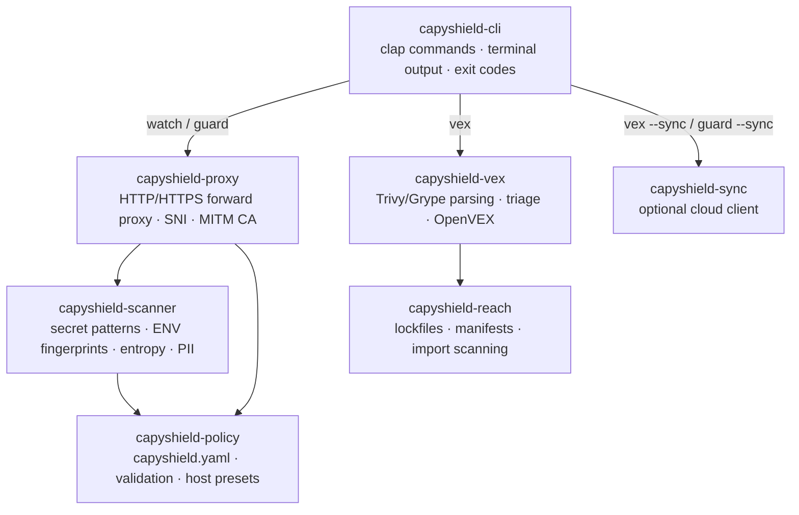
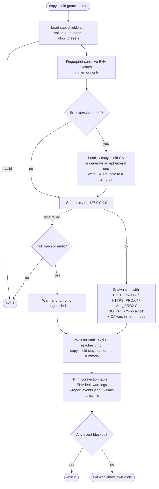
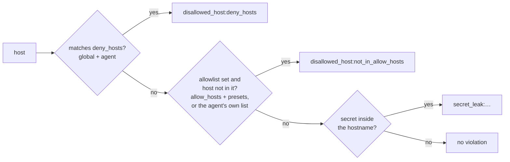
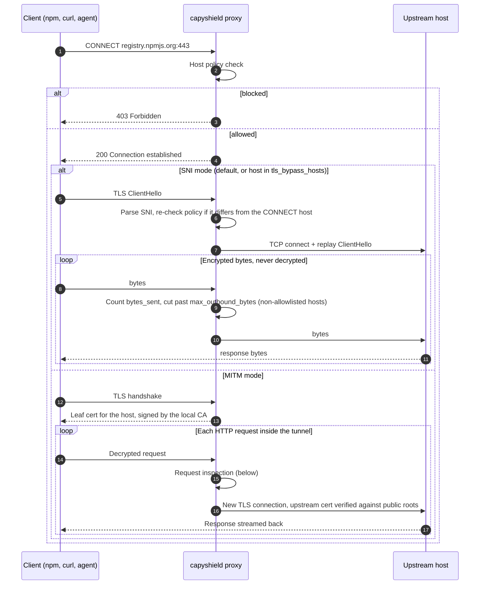
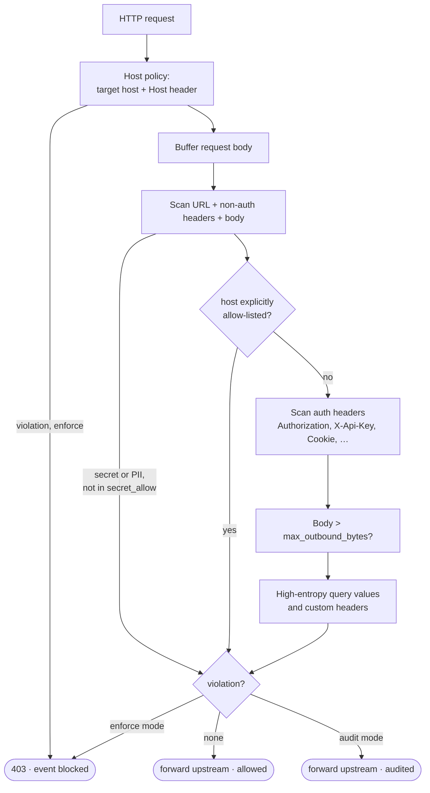
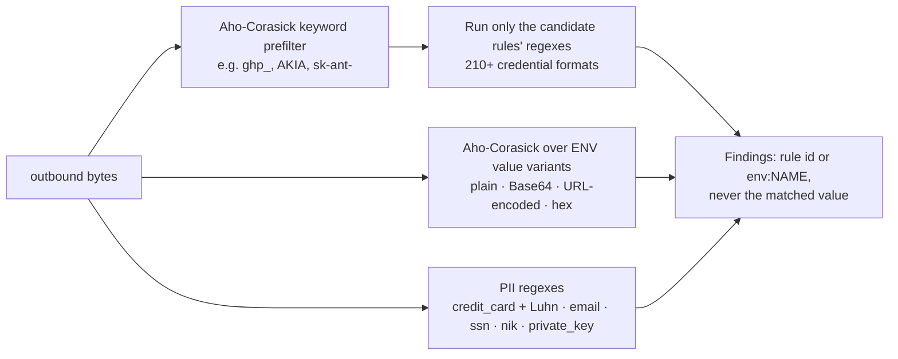
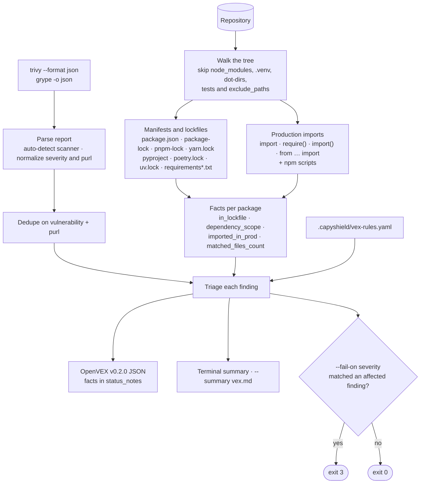
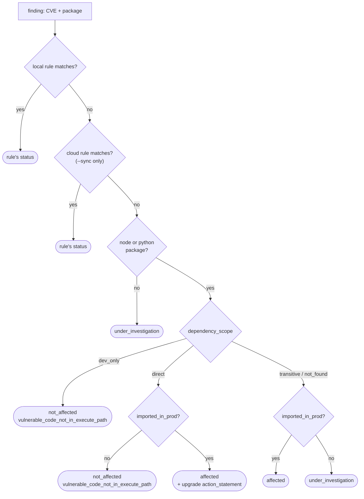
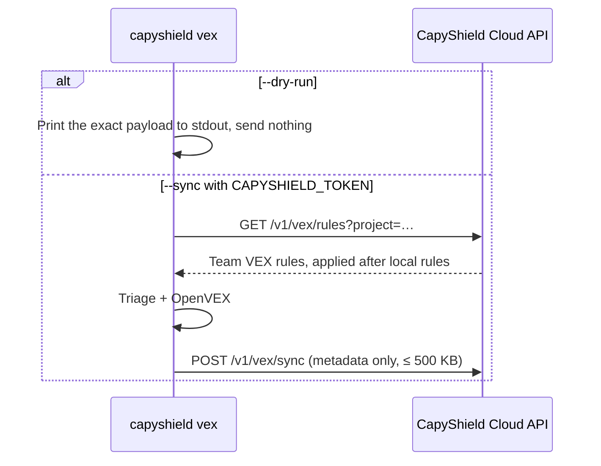
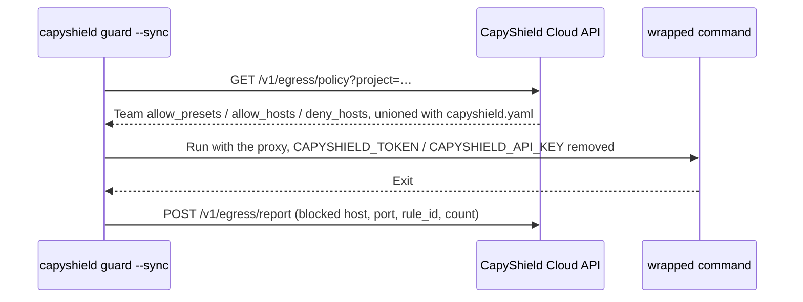

# How CapyShield works

This document explains what happens inside `capyshield` when you run `watch`, `guard` or `vex`. Everything described here runs locally, in a single process.

- [Architecture](#architecture)
- [Process wrapper: `watch` and `guard`](#process-wrapper-watch-and-guard)
- [Egress proxy](#egress-proxy)
  - [CONNECT tunnels: SNI and MITM](#connect-tunnels-sni-and-mitm)
  - [Request inspection](#request-inspection)
  - [Scanner pipeline](#scanner-pipeline)
- [VEX & reachability: `vex`](#vex--reachability-vex)
  - [Triage decision](#triage-decision)
  - [Cloud sync (optional)](#cloud-sync-optional)
- [Exit codes](#exit-codes)

## Architecture

The binary is a Cargo workspace of small, single-purpose crates. The CLI wires them together. Only `capyshield-sync` talks to the network on its own, and only with `vex --sync` or `guard --sync`.

## Process wrapper: `watch` and `guard`

`watch` and `guard` share one code path. `watch` forces `mode: audit` and `fail_mode: fail_open`. `guard` uses your `capyshield.yaml`, or enforces the built-in checks when there's no file.

Proxy variables are cooperative: tools that honor them (npm, pip, uv, curl, git, most SDKs) route through the proxy, but code that opens raw sockets can bypass it. For a hard boundary, run the command in a container or network namespace whose only route out is the proxy.

## Egress proxy

The proxy speaks plain HTTP/1.1 forward-proxy requests and `CONNECT` tunnels. Every decision produces one event: `timestamp`, `destination_host`, `port`, `protocol`, `bytes_sent`, `action` and `rule_id`.

The **host policy** check runs first for every connection, request and SNI name:

A violation becomes `blocked` in `enforce` mode and `audited` in `audit` mode. The agent identity comes from the `X-Agent-ID` request header, falling back to `--agent-id`.

### CONNECT tunnels: SNI and MITM

Notes:
- **Domain fronting:** in SNI mode, a ClientHello whose SNI differs from the CONNECT target is checked against the policy too. In MITM mode, a `Host` header that differs from the target is.
- **Fail modes:** in SNI mode, a tunnel that doesn't start with a TLS ClientHello within 3 seconds is blocked under `enforce` + `fail_closed`, and allowed otherwise. If a leaf certificate can't be generated, MITM falls back to an SNI tunnel under `fail_open` and blocks under `fail_closed`.
- **Long-lived tunnels:** events are recorded when the tunnel opens and their byte counts update live, so keep-alive connections that outlive the wrapped command still show up in the summary.

### Request inspection

This applies to plain HTTP requests and to every decrypted request in MITM mode:

Credentials in authentication headers sent to an allow-listed host count as normal API usage. The same value anywhere else in the request, or sent to any other host, counts as a leak. `secret_allow` grants named exceptions (`OPENAI_API_KEY: ["api.openai.com"]`).

### Scanner pipeline

The entropy check runs separately on individual header and query values (Shannon entropy ≥ `entropy_threshold`, tokens of 24+ characters, skipping SRI hashes like `sha512-…`).

## VEX & reachability: `vex`

### Triage decision

The first matching source wins:

Reachability is static and package-level: it works from lockfiles and import statements, not call graphs. Transitive packages that production code doesn't import directly stay `under_investigation` rather than being guessed. Record your own decisions as local rules.

### Cloud sync (optional)

The payload contains vulnerability ids, purls, statuses and reachability facts, never source code. With `--redact-paths`, file paths and the project name are replaced by deterministic `sha256:` hashes.

The team policy rejects unknown fields. If the pull or the report fails, `guard` warns and keeps enforcing the local policy; the exit code still reflects blocked egress.

## Exit codes

| Code | Meaning |
|---|---|
| `0` | Success, no egress violation (or audit mode). Otherwise the wrapped command's own exit code. |
| `1` | Internal error or invalid configuration |
| `2` | Egress violation blocked |
| `3` | `vex --fail-on` matched an `affected` finding |
